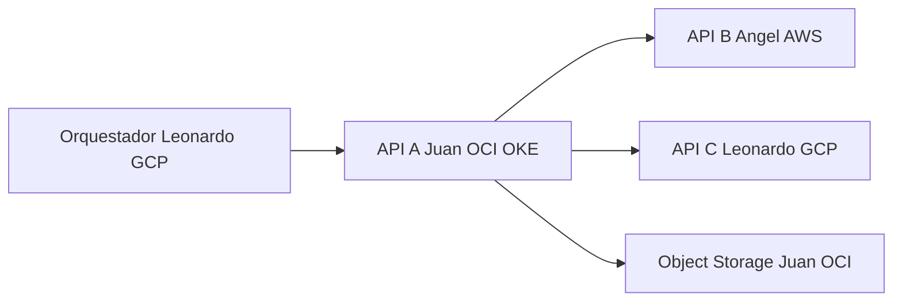

# Clic KiuSys PSS API

API REST para un mini PSS de aerolínea con las entidades **Vuelo**, **Pasajero** y **AsientoAsignado**.

Repositorio: https://github.com/juangz1912/clic_kiusys

## Arquitectura del grupo



| Integrante | Nube | Pieza |
|------------|------|--------|
| Juan José Giraldo | Oracle OCI | API A en OKE + Object Storage |
| Angel Avirama | AWS | API B adopción |
| Leonardo Giraldo | GCP | API C documentos + orquestador |

Servicios OCI usados: cluster OKE, registro OCIR, Load Balancer flexible (10 Mbps), Block Volume para Postgres, VCN y Object Storage. El DNS `sslip.io` apunta a la IP del balanceador sin costo.

URL pública: http://157-137-193-66.sslip.io

Juan también opera la capa de métricas del grupo en Grafana Cloud. Caché y cola las llevan otros integrantes.

| Integrante | Nube | Rol |
|------------|------|-----|
| Juan Jose Giraldo | **Oracle OCI (OKE)** | API A + Object Storage + métricas (Grafana Cloud) |
| Angel Avirama | **AWS** | API B — adopción ([Api_Pet_Adoption](https://github.com/AngelAvirama/Api_Pet_Adoption)) |
| Leonardo Giraldo | **GCP** | API C — documentos médicos ([MedicalDevops](https://github.com/LeonardoG2005/MedicalDevops)) |

- **Contrato del grupo:** cada API expone un GET random por entidad y un GET por id que trae una entidad random de cada compañero. Aquí es `GET /api/v2/entidades/vuelos/{id}` (Vuelo + Animal de Angel + Imagen de Leonardo).
- **Trace-id:** header `X-Trace-Id` y `traceparent` (W3C) en toda la cadena
- Guía detallada: [docs/GUIA_SEGUIMIENTO_2.md](docs/GUIA_SEGUIMIENTO_2.md)
- Integración del equipo: [docs/EQUIPO_INTEGRACION.md](docs/EQUIPO_INTEGRACION.md)
- Observabilidad: [docs/OBSERVABILITY.md](docs/OBSERVABILITY.md)

## Links de sustentación

**API A en OKE** (`http://157-137-193-66.sslip.io`)

| Qué mostrar | Link |
|-------------|------|
| Swagger | http://157-137-193-66.sslip.io/docs |
| Health (nube, cluster, trace_id) | http://157-137-193-66.sslip.io/api/v2/health |
| Vuelo random | http://157-137-193-66.sslip.io/api/v2/entidades/vuelos/random |
| Pasajero random | http://157-137-193-66.sslip.io/api/v2/entidades/pasajeros/random |
| Asiento asignado random | http://157-137-193-66.sslip.io/api/v2/entidades/asientos-asignados/random |
| Vuelo por id + Animal (AWS) + Imagen (GCP) | http://157-137-193-66.sslip.io/api/v2/entidades/vuelos/1 |
| Métricas RED del pod (p50/p95) | http://157-137-193-66.sslip.io/api/v2/metrics |
| Snapshots en Object Storage | http://157-137-193-66.sslip.io/api/v2/storage/flujo |
| Fallo provocado (dispara la alerta) | http://157-137-193-66.sslip.io/api/v2/demo/fallo |

**Observabilidad**

| Qué mostrar | Link |
|-------------|------|
| Tablero RED del grupo (Grafana Cloud) | https://browngecko19.grafana.net/d/clic-s2-red/multicloud-s2-red-por-api |
| Tablero público (sin cuenta, solo lectura) | https://browngecko19.grafana.net/public-dashboards/36289f533814429484c024d748923642 |
| Alerta "API A - errores 5xx" | https://browngecko19.grafana.net/alerting/list |
| Trazas y métricas (Explore) | https://browngecko19.grafana.net/explore |
| Alarma nativa OCI (CPU de nodos OKE) | https://cloud.oracle.com/monitoring/alarms?region=sa-bogota-1 |
| OCI Logging (log group `clic-kiusys`) | https://cloud.oracle.com/logging/log-groups?region=sa-bogota-1 |
| Cluster OKE | https://cloud.oracle.com/containers/clusters?region=sa-bogota-1 |
| Bucket `clic-kiusys-flow` | https://cloud.oracle.com/object-storage/buckets/ax5bqkfrllcm/clic-kiusys-flow/objects?region=sa-bogota-1 |

**Repositorio**

| Qué mostrar | Link |
|-------------|------|
| Release v2.2.1 | https://github.com/juangz1912/clic_kiusys/releases/tag/v2.2.1 |
| Pipelines | https://github.com/juangz1912/clic_kiusys/actions |

**Compañeros**

| API | Link |
|-----|------|
| API B Angel (AWS): animal random | http://aa11cf2e5dd814f8cbf7485099e3b46f-618055784.us-east-1.elb.amazonaws.com/api/v2/animals/random |
| API B Angel (AWS): health | http://aa11cf2e5dd814f8cbf7485099e3b46f-618055784.us-east-1.elb.amazonaws.com/api/v2/health |
| API C Leonardo (GCP): health | http://medical-documents-api-34-123-58-136.sslip.io/health |
| API C Leonardo (GCP): documentación | http://medical-documents-api-34-123-58-136.sslip.io/documentation |
| API C Leonardo (GCP): composición | http://medical-documents-api-34-123-58-136.sslip.io/api/v2/imagenes/1/composition |

**Comandos de la demo**

```bash
# Trace-id de punta a punta
curl -i -H "X-Trace-Id: sustentacion-1" http://157-137-193-66.sslip.io/api/v2/entidades/vuelos/1

# Escalamiento: el HPA sube de 2 a 5 réplicas (y puede disparar la alarma de CPU de OCI)
./scripts/k8s_hpa_demo.sh

# Alerta: 30 respuestas 500 en 1 minuto, Grafana pasa a Firing y manda correo
./scripts/demo_alerta.sh
```

## Entidades (v1)

| Entidad | Descripción |
|---------|-------------|
| Vuelo | Inventario / schedule del vuelo |
| Pasajero | Perfil del pasajero |
| AsientoAsignado | Asignación de asiento con hold de 10 min |

Estados de asiento: `seleccionado`, `asignado`, `expirado`.

## Endpoints principales

- CRUD v1: `/api/vuelos`, `/api/pasajeros`, `/api/asientos-asignados`
- **QUERY:** `POST /api/vuelos/query`, etc.
- Health v1: `/api/health`
- **v2 multicloud:**
  - `GET /api/v2/entidades/{vuelos|pasajeros|asientos-asignados}/random`
  - `GET /api/v2/entidades/vuelos/{id}` con una entidad random de cada compañero
  - `POST /api/v2/flujo` y `POST /api/v2/mensaje` (el mensaje queda en Object Storage)
  - `GET /api/v2/storage/flujo`, `/api/v2/health`, `/api/v2/metrics`
  - `GET /api/v2/demo/fallo` (solo con `DEMO_FAILURE_ENABLED=true`)
- Docs: `/docs`

## Ambientes

| Ambiente | URL cloud | API local | Base de datos |
|----------|-----------|-----------|---------------|
| **OKE (OCI, sa-bogota-1) — Seguimiento #2** | http://157-137-193-66.sslip.io | — | Postgres en cluster (block volume OCI) |
| Pruebas (Render, legado S1) | https://clic-kiusys-pruebas.onrender.com | http://localhost:8001 | postgres puerto 5433 |
| Producción (Render, legado S1) | https://clic-kiusys-prod.onrender.com | http://localhost:8002 | postgres puerto 5434 |

## Ejecución local

```bash
python -m venv .venv
source .venv/bin/activate
pip install -r requirements.txt
pytest --cov=app --cov-report=term-missing
docker compose up -d
python scripts/test_v2_endpoints.py http://localhost:8001
```

Variables Seguimiento #2: ver [.env.example](.env.example).

## Despliegue Render (Seguimiento #1)

El archivo `render.yaml` define 2 Web Services y **1 instancia PostgreSQL** con 2 bases (`pss_pruebas`, `pss_produccion`).

Secrets GitHub: `RENDER_DEPLOY_HOOK_PRUEBAS`, `RENDER_DEPLOY_HOOK_PRODUCCION`, `RENDER_API_KEY`.

## Despliegue OKE (Seguimiento #2)

Guía completa: [docs/OCI_DEPLOY.md](docs/OCI_DEPLOY.md)

```bash
cp scripts/oci/oci.env.example scripts/oci/oci.env   # completar y NO commitear
chmod +x scripts/oci/*.sh
./scripts/oci/deploy_all.sh
```

Plantilla para el equipo: [docs/EQUIPO_INTEGRACION.md](docs/EQUIPO_INTEGRACION.md)

## Pipelines

- `deploy-oke.yml` — en `main`: tests, imagen amd64 a OCIR y rollout en OKE
- `deploy-render.yml` — hook de Render en `develop` (pruebas) y `main` (producción)

## Stack

- Python 3.12 + FastAPI
- PostgreSQL
- Docker / OKE (Kubernetes)
- Render + **Oracle OCI**
- GitHub Actions

## Versionado

Ver [CHANGELOG.md](CHANGELOG.md). Release **v2.2.1** (Seguimiento #2: OKE, contrato random, Grafana Cloud y alertas).
