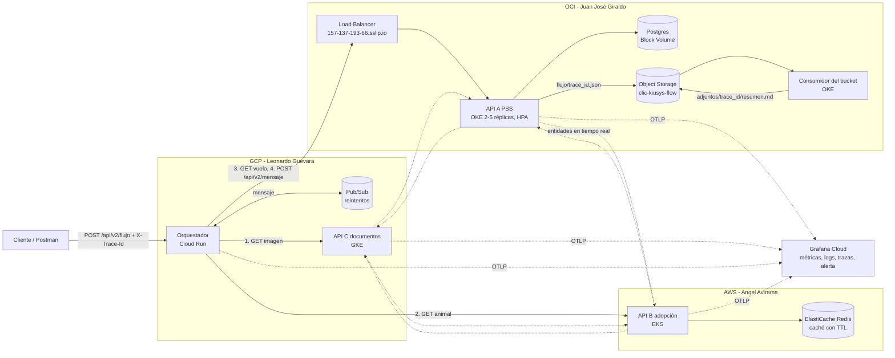
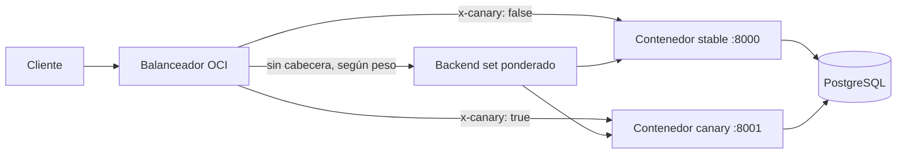
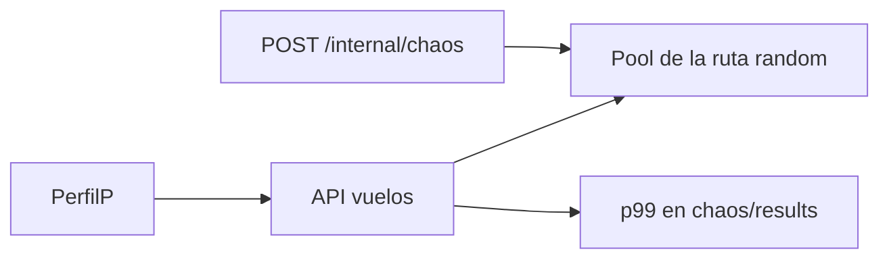
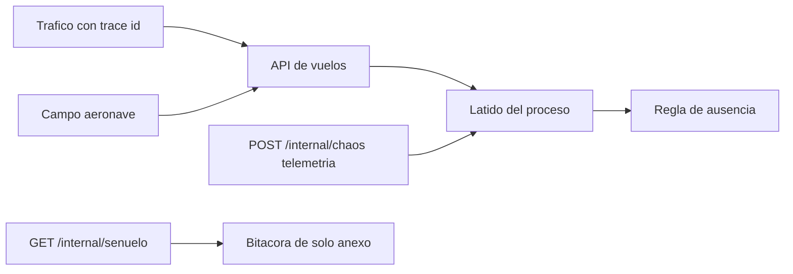

# Clic KiuSys PSS API

API REST para un mini PSS de aerolínea con las entidades **Vuelo**, **Pasajero** y **AsientoAsignado**.

Repositorio: https://github.com/juangz1912/clic_kiusys

## Arquitectura del grupo



| Integrante | Nube | API | Componente transversal |
|------------|------|-----|------------------------|
| Juan José Giraldo | **Oracle OCI** (OKE) | API A: Vuelo, Pasajero, AsientoAsignado (este repo) | Object Storage + consumidor ([storage_consumer](storage_consumer/README.md)) y capa SaaS de observabilidad (Grafana Cloud) |
| Angel Avirama | **AWS** (EKS) | API B: Animal, Adoptante, Adopción ([Api_Pet_Adoption](https://github.com/AngelAvirama/Api_Pet_Adoption)) | Caché Redis (ElastiCache) |
| Leonardo Guevara | **GCP** (GKE + Cloud Run) | API C: Imagen, NotaMedica, DocumentoGenerado ([MedicalDevops](https://github.com/LeonardoG2005/MedicalDevops)) | Orquestador + cola Pub/Sub |

URL pública de la API A: https://clic-kiusys-vuelos.up.railway.app

El host viejo `http://157-137-193-66.sslip.io` ya no es esta API. Responde 308 a HTTPS y después `404 {"error":"no encontrado"}` desde un puente Python. El enlace que hay que usar, en https y sin redirección, es el de arriba. Health y vuelo random responden 200.

### Servicios adicionales (OCI)

| Servicio | Para qué |
|----------|----------|
| Load Balancer flexible de OCI (Service `LoadBalancer`) | Punto de entrada único para los compañeros y el orquestador; reparte entre las réplicas y saca de rotación los pods que fallan la readiness probe. |
| DNS con `sslip.io` | Nombre estable para la IP del balanceador sin comprar dominio; es el que tienen configurado Angel, Leonardo y el orquestador. |
| OCI Container Registry (OCIR) | Registro privado en la misma región del cluster. Cada imagen lleva el SHA del commit, así un rollback apunta a una versión exacta. |
| Gestión de secretos | Kubernetes Secrets para la base, las llaves S3 del bucket y el header OTLP de Grafana; GitHub Actions Secrets para las credenciales del pipeline. Nada de eso está en git. |
| HPA + metrics-server | Escala la API de 2 a 5 réplicas por CPU (`scripts/k8s_hpa_demo.sh`). |
| OCI Monitoring, Notifications y Logging | Alarma de CPU de los nodos con aviso por correo y log group `clic-kiusys` con los logs JSON de los pods. |
| Block Volume | Disco persistente para Postgres dentro del cluster. |

- **Contrato del grupo:** cada API expone un GET random por entidad y un GET por id que trae una entidad random de cada compañero. Aquí es `GET /api/v2/entidades/vuelos/{id}` (Vuelo + Animal de Angel + Imagen de Leonardo).
- **Trace-id:** header `X-Trace-Id` y `traceparent` (W3C) en toda la cadena
- Guía detallada: [docs/GUIA_SEGUIMIENTO_2.md](docs/GUIA_SEGUIMIENTO_2.md)
- Integración del equipo: [docs/EQUIPO_INTEGRACION.md](docs/EQUIPO_INTEGRACION.md)
- Observabilidad: [docs/OBSERVABILITY.md](docs/OBSERVABILITY.md)

## Links de sustentación

**API A vigente** (`https://clic-kiusys-vuelos.up.railway.app`)

| Qué mostrar | Link |
|-------------|------|
| Swagger | https://clic-kiusys-vuelos.up.railway.app/docs |
| Health (nube, cluster, trace_id) | https://clic-kiusys-vuelos.up.railway.app/api/v2/health |
| Vuelo random | https://clic-kiusys-vuelos.up.railway.app/api/v2/entidades/vuelos/random |
| Pasajero random | https://clic-kiusys-vuelos.up.railway.app/api/v2/entidades/pasajeros/random |
| Asiento asignado random | https://clic-kiusys-vuelos.up.railway.app/api/v2/entidades/asientos-asignados/random |
| Vuelo por id + Animal (AWS) + Imagen (GCP) | https://clic-kiusys-vuelos.up.railway.app/api/v2/entidades/vuelos/1 |
| Métricas RED del pod (p50/p95) | https://clic-kiusys-vuelos.up.railway.app/api/v2/metrics |
| Snapshots en Object Storage | https://clic-kiusys-vuelos.up.railway.app/api/v2/storage/flujo |
| Mensaje de un flujo del orquestador | https://clic-kiusys-vuelos.up.railway.app/api/v2/storage/flujo/revision-final-1 |
| Adjunto generado por el consumidor | https://clic-kiusys-vuelos.up.railway.app/api/v2/storage/adjunto/revision-final-1/resumen.md |
| Estado del fallo del paso api_a | https://clic-kiusys-vuelos.up.railway.app/api/v2/demo/fallo-flujo |

**Observabilidad**

| Qué mostrar | Link |
|-------------|------|
| Tablero RED del grupo (Grafana Cloud) | https://browngecko19.grafana.net/d/clic-s2-red/multicloud-s2-red-por-api |
| Tablero público (sin cuenta, solo lectura) | https://browngecko19.grafana.net/public-dashboards/36289f533814429484c024d748923642 |
| Alerta "API A - errores 5xx" | https://browngecko19.grafana.net/alerting/list |
| Trazas y métricas (Explore) | https://browngecko19.grafana.net/explore |
| Alarma nativa OCI (CPU de nodos OKE) | https://cloud.oracle.com/monitoring/alarms?region=sa-bogota-1 |
| OCI Logging (log group `clic-kiusys`) | https://cloud.oracle.com/logging/log-groups?region=sa-bogota-1 |
| Cluster OKE | https://cloud.oracle.com/containers/clusters?region=sa-bogota-1 |
| Bucket `clic-kiusys-flow` | https://cloud.oracle.com/object-storage/buckets/ax5bqkfrllcm/clic-kiusys-flow/objects?region=sa-bogota-1 |

**Repositorio**

| Qué mostrar | Link |
|-------------|------|
| Release v2.3.0 | https://github.com/juangz1912/clic_kiusys/releases/tag/v2.3.0 |
| Pipelines | https://github.com/juangz1912/clic_kiusys/actions |

**Compañeros**

| API | Link |
|-----|------|
| API B Angel (AWS): animal random | http://aa11cf2e5dd814f8cbf7485099e3b46f-618055784.us-east-1.elb.amazonaws.com/api/v2/animals/random |
| API B Angel (AWS): health | http://aa11cf2e5dd814f8cbf7485099e3b46f-618055784.us-east-1.elb.amazonaws.com/api/v2/health |
| API C Leonardo (GCP): health | http://medical-documents-api-34-123-58-136.sslip.io/health |
| API C Leonardo (GCP): documentación | http://medical-documents-api-34-123-58-136.sslip.io/documentation |
| API C Leonardo (GCP): composición | http://medical-documents-api-34-123-58-136.sslip.io/api/v2/imagenes/1/composition |

**Comandos de la demo**

```bash
# Flujo completo: orquestador (GCP) -> Pub/Sub -> API C (GCP) -> API B (AWS) -> API A (OCI) -> Object Storage
curl -X POST -H "Content-Type: application/json" -H "X-Trace-Id: sustentacion-1" \
  -d '{"resource":"imagen","id":1}' https://medical-orchestrator-400345348270.us-central1.run.app/api/v2/flujo
curl https://clic-kiusys-vuelos.up.railway.app/api/v2/storage/flujo/sustentacion-1
curl https://clic-kiusys-vuelos.up.railway.app/api/v2/storage/adjunto/sustentacion-1/resumen.md

# Modificar un dato en tiempo real y verlo en el siguiente mensaje
curl -X PUT -H "Content-Type: application/json" -d '{"destino":"CTG"}' https://clic-kiusys-vuelos.up.railway.app/api/vuelos/1

# Escalamiento: el HPA sube de 2 a 5 réplicas (y puede disparar la alarma de CPU de OCI)
./scripts/k8s_hpa_demo.sh

# Alerta por un fallo en un paso del flujo: el paso api_a responde 500, Pub/Sub reintenta,
# la alerta pasa a Firing y llega el correo. Al desactivar, se reprocesan los mensajes y la alerta se resuelve.
./scripts/demo_fallo_flujo.sh activar
./scripts/demo_fallo_flujo.sh desactivar
```

## Entidades (v1)

| Entidad | Descripción |
|---------|-------------|
| Vuelo | Inventario / schedule del vuelo |
| Pasajero | Perfil del pasajero |
| AsientoAsignado | Asignación de asiento con hold de 10 min |

Estados de asiento: `seleccionado`, `asignado`, `expirado`.

## Endpoints principales

- CRUD v1: `/api/vuelos`, `/api/pasajeros`, `/api/asientos-asignados`
- **QUERY:** `POST /api/vuelos/query`, etc.
- Health v1: `/api/health`
- **v2 multicloud:**
  - `GET /api/v2/entidades/{vuelos|pasajeros|asientos-asignados}/random`
  - `GET /api/v2/entidades/vuelos/{id}` con una entidad random de cada compañero
  - `POST /api/v2/flujo` y `POST /api/v2/mensaje` (el mensaje queda en Object Storage)
  - `GET /api/v2/storage/flujo`, `/api/v2/storage/flujo/{trace_id}`, `/api/v2/storage/adjunto/{trace_id}/{archivo}`
  - `/api/v2/health`, `/api/v2/metrics`
  - `GET|PUT /api/v2/demo/fallo-flujo` y `GET /api/v2/demo/fallo` (solo con `DEMO_FAILURE_ENABLED=true`)
- Docs: `/docs`

## Ambientes

| Ambiente | URL cloud | API local | Base de datos |
|----------|-----------|-----------|---------------|
| **Pública vigente** | https://clic-kiusys-vuelos.up.railway.app | — | SQLite en el servicio, con el vuelo CA100 |
| Pruebas (Render, legado S1) | https://clic-kiusys-pruebas.onrender.com | http://localhost:8001 | postgres puerto 5433 |
| Producción (Render, legado S1) | https://clic-kiusys-prod.onrender.com | http://localhost:8002 | postgres puerto 5434 |

## Ejecución local

```bash
python -m venv .venv
source .venv/bin/activate
pip install -r requirements.txt
pytest --cov=app --cov-report=term-missing
docker compose up -d
python scripts/test_v2_endpoints.py http://localhost:8001
```

Variables Seguimiento #2: ver [.env.example](.env.example).

## Despliegue Render (Seguimiento #1)

El archivo `render.yaml` define 2 Web Services y **1 instancia PostgreSQL** con 2 bases (`pss_pruebas`, `pss_produccion`).

Secrets GitHub: `RENDER_DEPLOY_HOOK_PRUEBAS`, `RENDER_DEPLOY_HOOK_PRODUCCION`, `RENDER_API_KEY`.

## Terraform (Seguimiento #3)

La infraestructura de OCI se crea con Terraform, un archivo por servicio, en [terraform/readme.md](terraform/readme.md).

```bash
cd terraform
source ./env.sh
terraform apply
bash instalar_api.sh
bash destruir.sh    # al terminar la sustentación
```

## Canary (entrega de despliegue)

El API estable (v2) y el canary (v3) corren en la misma VM Always Free de OCI (`VM.Standard.A1.Flex`, 1 OCPU y 6 GB), como dos contenedores de una imagen identificada por digest. El balanceador de OCI reparte el tráfico. Hay que destruir la VM al terminar la sustentación con `bash terraform/destruir.sh`. Documentación de la estrategia que se tomó de referencia: [estrategias de Cloud Deploy](https://docs.cloud.google.com/deploy/docs/deployment-strategies?hl=es-419). Aquí el mecanismo es el de OCI, que es la nube del integrante A.



No hay sticky sessions: cada petición se sortea de nuevo, para que la muestra del canary no se quede pegada a unos pocos clientes. Quien quiera fijar el track usa la cabecera.

| Etapa | Tráfico público al canary | Horneado | Cómo entrar |
| --- | --- | --- | --- |
| 0 | 0% | 0 | Solo `x-canary: true` |
| 1 | 10% | 10 min | Tráfico normal, más la cabecera para forzar |
| 2 | 50% | 10 min | Igual |
| 3 | 100% | 5 min | Todo el público cae en v3 |

Expand/Contract: `vuelos.estado_operativo` se agrega con default `programado`. v2 no lo devuelve ni lo exige. No se borra ni se renombra ninguna columna, así un rollback del canary no toca los datos.

El cambio visible de v3 es ese estado (`programado`, `demorado`, `cancelado`) en `/api/v3/entidades/vuelos`. Cada respuesta lleva `X-App-Version` y `X-App-Track`.

La decisión de promover o abortar está en `canary/slo.json` y `canary/estadistica.py`: mínimo 50 peticiones por track, prueba z al 95% contra el baseline, y aborto si el canary pasa de 5% de 5xx o si su p95 crece más del doble. `PUT /api/v3/demo/degradacion` inyecta errores o latencia solo en el canary, y no toca `/health`, `/sli` ni el propio interruptor: el balanceador sigue viendo el backend sano y la muestra no se diluye con chequeos.

```bash
bash canary/carga.sh http://IP 50
python3 canary/evaluar.py http://IP
bash canary/peso.sh 10    # o 0 para abortar
```

Tablero en vivo: `http://IP/tablero`. Compara stable y canary lado a lado.

OCI Bogotá no tiene capacidad Ampere y la cuota de E5 está en cero. El mismo reparto (cabecera y pesos 0, 10, 50, 100) queda levantado con nginx y dos contenedores de la misma imagen:

```bash
CANARY_BACKEND=compose bash canary/peso_compose.sh 0
docker compose -f canary/compose/docker-compose.yml up -d --build
CANARY_BACKEND=compose bash canary/demo.sh http://127.0.0.1:8080
```

## Release 5: Ingeniería del Caos

La API de vuelos es la segunda dependencia del flujo del coordinador. El fallo de este integrante es el agotamiento del pool de la ruta `GET /api/v2/entidades/vuelos/random`. La métrica única es el p99. El informe, con las dos rondas, está en [chaos/informe-experimento.md](chaos/informe-experimento.md). El game day de telemetría es otro documento: [chaos/security/informe-game-day.md](chaos/security/informe-game-day.md).



El punto de inyección es solo ese pool, dentro de este proceso. El radio no incluye la base como dato, ni la API de adopción en AWS, ni el coordinador en GCP. Ahí se mide el p99: en la carga del perfil P, guardada en `chaos/results/`.

| Integrante | Dónde | Fallo | Métrica | Patrón |
| --- | --- | --- | --- | --- |
| Juan | API de vuelos, OCI | Agotamiento del pool | p99 menor a 2000 ms | Admisión con 429 y mamparo de 400 ms |
| Adopción | AWS | Latencia o caída, en ese repo | La de esa hipótesis | La que salga de su ronda 0 |
| Coordinador | GCP | El fallo distinto que falta | La de esa hipótesis | La que salga de su ronda 0 |

Los tres fallos tienen que ser de naturaleza distinta. Aquí solo está implementado el de Juan. Los otros dos no se inventan en este repositorio.

Del seguimiento 2 se conserva la API v2, el `X-Trace-Id` y el modelo de vuelos. No se reconstruye la cola ni la caché. El clúster de OKE ya no existe. El mensaje del orquestador (`POST /api/v2/mensaje`) se puede llamar, pero no entra en este flujo. El consumidor de Object Storage queda en el repo y no participa en el experimento.

La URL que el coordinador debe guardar en `medical-api-api-a-url` es `https://clic-kiusys-vuelos.up.railway.app`. El host `157-137-193-66.sslip.io` responde 404 desde un puente que no es esta API.

```bash
python3 chaos/run_rondas.py
python3 chaos/gate.py
```

## Defensa en profundidad

El informe de controles es otro archivo, `chaos/security/informe-game-day.md`. No usa el p99. El experimento de este integrante es el 3: telemetría y dato. Los experimentos 1, 2 y 4 no se rellenan desde aquí.



La frontera de esta capa es el proceso. No incluye la red de AWS ni la de GCP. La telemetría se recoge en `GET /internal/latido` y en `chaos/bitacora/eventos.log`.

| Control | Experimento | Marco |
| --- | --- | --- |
| Latido | 3, pausa de telemetría | D3-PM, ISO 27001 A.8.16, NIST AU-5, verificación continua al estilo 800-207 |
| Bitácora de solo anexo | 3, intento de truncar | ISO 27001 A.8.15, ATT&CK T1070 |
| Señuelo | 3, ruta que el flujo no llama | D3-DO |
| Dato que no es una orden | 3, inyección en `aeronave` | OWASP LLM01, ATLAS AML.T0051 |

```bash
python3 chaos/security/run_game_day.py
```

## Despliegue OKE (Seguimiento #2)

Guía completa: [docs/OCI_DEPLOY.md](docs/OCI_DEPLOY.md)

```bash
cp scripts/oci/oci.env.example scripts/oci/oci.env   # completar y NO commitear
chmod +x scripts/oci/*.sh
./scripts/oci/deploy_all.sh
```

Plantilla para el equipo: [docs/EQUIPO_INTEGRACION.md](docs/EQUIPO_INTEGRACION.md)

## Pipelines

- `canary.yml` — manual: fija el porcentaje del canary (0, 10, 50, 100) y puede reinstalar los dos contenedores
- `chaos-gate.yml` — manual, solo con la ventana autorizada: corre las dos rondas, revierte y falla si el p99 de la ronda 1 pasa de 2000 ms
- `terraform-oci.yml` — manual: `terraform apply` e instala el API en la VM
- `terraform-destruir.yml` — manual: `terraform destroy`
- `deploy-oke.yml` — manual. El clúster del seguimiento 2 ya no existe
- `deploy-storage-consumer.yml` — en `main` cuando cambia `storage_consumer/`: tests, imagen a OCIR y rollout del consumidor
- `deploy-render.yml` — hook de Render en `develop` (pruebas) y `main` (producción)

## Stack

- Python 3.12 + FastAPI
- PostgreSQL
- Docker / OKE (Kubernetes)
- Render + **Oracle OCI**
- GitHub Actions

## Versionado

Ver [CHANGELOG.md](CHANGELOG.md). Release **v5.1.1** (las rondas del pool medidas con k6, encima del game day v5.1.0). El canary quedó documentado como v4.0.0.
